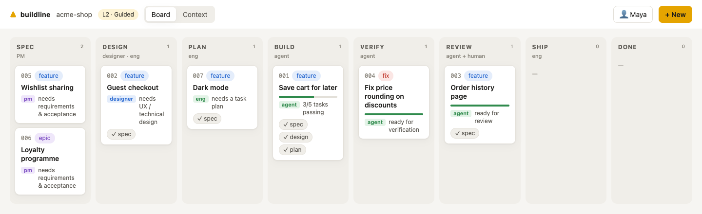
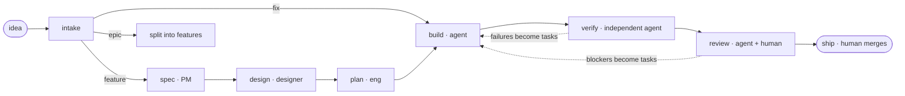
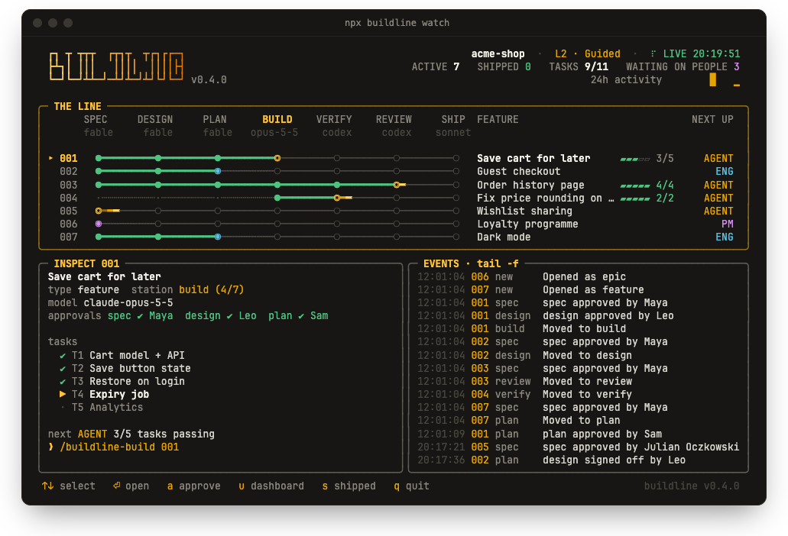
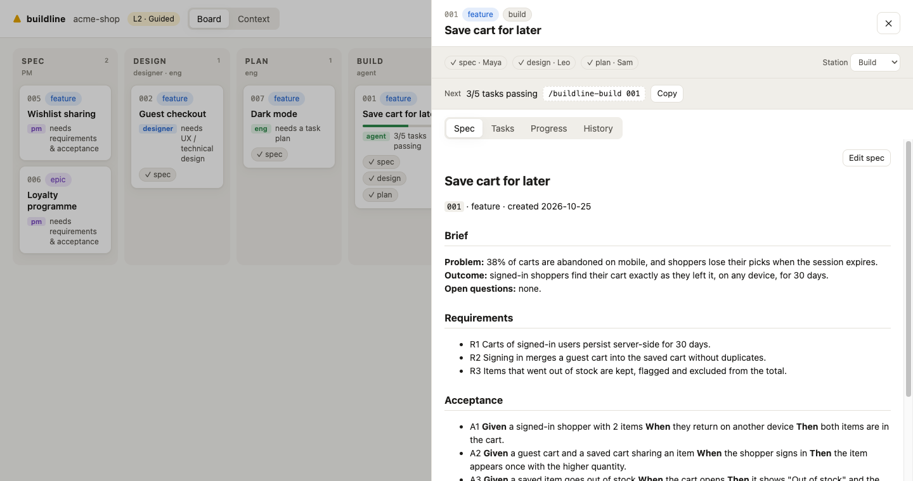

<div align="center">

<picture>
  <source media="(prefers-color-scheme: dark)" srcset="docs/assets/logo-dark.svg">
  
</picture>

**Install an AI software factory into any project, in one command.**

A spec-driven pipeline that coding agents follow from idea to merged PR, with real quality gates,<br>
independent verification, and a clear place for developers, designers and product managers.

[](https://www.npmjs.com/package/buildline)
[](#requirements)
[](LICENSE)

**Works with** Claude Code · Codex · Cursor · Gemini CLI · GitHub Copilot · anything that reads `AGENTS.md`

```bash
npx buildline
```

**[Website & docs](https://julianoczkowski.github.io/buildline/)** · [Quick start](#quick-start) · [How it works](#how-it-works) · [Models per station](#models-per-station) · [Watch](#watch-the-line) · [Dashboard](#the-dashboard) · [Upgrading](#upgrading)

</div>

<br>

<picture>
  <source media="(prefers-color-scheme: dark)" srcset="docs/assets/dashboard-dark.png">
  
</picture>

## Why Buildline

Coding agents can build most of a feature now, but only when the repo gives them three things most repos don't:

| | Without it | With Buildline |
|---|---|---|
| **A definition of done** | "Make saved carts work." | Requirements and Given/When/Then scenarios a human owns, locked while the agent builds. |
| **A way to check the work** | "It works on my end." | Your lint, types, tests and build as gates, plus a verifier that never saw the code being written. |
| **Memory between sessions** | Every chat starts from zero. | Specs, task lists with `passes` flags and progress logs on disk, so any session picks up where the last one stopped. |

And it's sized to the change: a typo doesn't go through a six-document ceremony, and an epic gets split before anyone writes code.

## Quick start

```bash
cd your-project            # empty folder or a ten-year-old monorepo
npx buildline              # detects your stack, asks 5 questions, shows every file before writing
```

Then, in Claude Code:

```text
/buildline-onboard                         new project: interview + scaffold · existing: map the codebase
/buildline-new Let users save carts for later
/buildline                                 where things stand and what's next, any time
```

Not on Claude Code? Ask your agent to *"follow `.buildline/stations/buildline.md`"*. Every station is a plain markdown playbook.

## How it works



Every change is one folder, `.buildline/features/004-saved-carts/`:

- **`spec.md`**: brief, requirements, acceptance scenarios, design, plan. Aim for one screen.
- **`feature.json`**: status, approvals, and tasks that only flip to `"passes": true` on evidence.
- **`progress.md`**: an append-only log, so the next session (human or agent) knows what happened.

## Built for the whole team

| | Start with | You own |
|---|---|---|
| **Product managers** | `npx buildline ui`, `/buildline-new`, `/buildline-spec` | requirements, acceptance scenarios, spec approval |
| **Designers** | `context/design.md`, `/buildline-design` with a Figma link or screenshots | flows, states, components, design approval |
| **Developers** | `/buildline`, `/buildline-build`, `npx buildline run <id>` | technical design, the plan, the merge |

Role guides: [product managers](docs/for-product-managers.md) · [designers](docs/for-designers.md) · [developers](docs/for-developers.md)

## Models per station

Pick the model for each job: Fable to plan, Opus to build, Codex to review, or anything else your tools support. Buildline doesn't ship a model list. The picker reads what's available from your installed Claude Code and the Anthropic API, and you can always type a model in, so new models work on day one.

```bash
npx buildline models                               # pick by phase or per station
npx buildline models set planning fable            # spec, design, plan
npx buildline models set building claude-opus-5-5  # build
npx buildline models check                         # what each choice resolves to today
```

```json
"models": { "plan": "fable", "build": "claude-opus-5-5", "review": "codex", "default": "sonnet" }
```

Claude Code skills and subagents switch model per station. A station set to Codex or Gemini is handed off automatically, and `buildline step <station> <id>` opens it in the right tool. [More on models →](docs/models.md)

## Guardrails that hold

Instructions in prose are advice. These are enforced:

- **Acceptance lock.** A Claude Code hook blocks edits to a spec's `## Acceptance` while the feature is in build, verify or review. Agents can't move the goalposts.
- **Independent verification.** The verifier subagent starts in a clean context with only the spec, so the builder never grades its own work.
- **Evidence before `passes`.** A task is done only after its verification step and the gates have been run and observed.
- **Checked review.** The reviewer follows your `REVIEW.md`, a second agent confirms every finding from the code before it costs a round, old bugs are labelled pre-existing, and after three rounds a person decides how to go on. [Modelled on how Anthropic reviews agent-written code →](docs/concepts.md#review)
- **Sensitive paths need a person.** List paths like `billing/` or CI workflows in `review.sensitive`. A feature that touches them can't ship until someone approves the exact commit, at any autonomy level.
- **Humans merge.** Always, at every autonomy level.
- **Your files stay yours.** Buildline adds marked blocks to files you own, tracks its own files by hash, keeps your edits on `update`, and `remove` restores your settings exactly.

## Autonomy you can dial up

| Level | Humans approve | Agents do alone |
|---|---|---|
| **1 · Assist** | every station | nothing without a yes |
| **2 · Guided** *(default)* | spec, plan, merge | build, verify, review |
| **3 · Autopilot** | spec, merge | plan → review unattended with `buildline run <id>` (Claude Code `/goal`) |
| **4 · Dark factory** | merge | everything up to a ready PR |

Start at 2. Raise it as your gates and acceptance scenarios earn trust. [More on autonomy →](docs/autonomy.md)

## Watch the line

`npx buildline watch` is the same picture for the terminal: every feature on its own track through the stations, updating live as agents and people move work along.



- a **comet** on the track means a Claude Code session is working on it right now, with its latest step; **NEEDS YOU** and **BLOCKED** mean an agent is waiting on your answer, permission or reply; **BACKGROUND** means it's waiting on something else, such as CI or a background agent, and will carry on by itself
- run several sessions at once, one per feature: each gets its own track
- the model under each station is the one that runs it
- `↑↓` to inspect tasks and history, `⏎` to open the station on its model, `a` to approve, `e` to hide the event log, `q` to quit
- a **chime** when a feature starts waiting on you or ships, so you can look away; `m` mutes it, `npx buildline sound off` turns it off for good (the dashboard chimes too)

## The dashboard

`npx buildline ui` opens a local board so people who don't live in a terminal can take part:

- see every feature by station
- read and edit specs, approve stages, and move work along
- copy the exact command to continue in Claude Code

It runs on `127.0.0.1`, needs no account, and only touches Buildline's markdown files.

<picture>
  <source media="(prefers-color-scheme: dark)" srcset="docs/assets/drawer-dark.png">
  
</picture>

## What gets installed

<details>
<summary>Everything is plain markdown, JSON and two zero-dependency scripts.</summary>

```text
AGENTS.md                       + Buildline block: rules, pipeline, gates (read by every agent)
CLAUDE.md                       + Buildline block: imports AGENTS.md, lists skills
.claude/skills/buildline-*/     11 skills: /buildline, /buildline-new, /buildline-spec … /buildline-autopilot
.claude/agents/buildline-*.md   6 subagents: spec-critic, verifier, reviewer, finding-checker, design-reviewer, mapper
.claude/settings.json           + hooks (session briefing, acceptance lock) + gate permissions
.cursor/rules/buildline.mdc     if you use Cursor
GEMINI.md                       + import block, if you use Gemini CLI
.github/workflows/buildline.yml optional: gates on every PR + Claude review against the spec
REVIEW.md                       what review should care about in this repo     yours
.buildline/
  buildline.json                autonomy, gates, models, review, team, agents  yours
  principles.md                 the non-negotiables every change is checked against   yours
  context/                      product · architecture · design system        yours
  stations/                     one playbook per station                       managed
  features/                     your work
  bin/gates.mjs, hook.mjs       quality gates and Claude Code hooks
```

Works alongside an existing `CLAUDE.md`, `AGENTS.md`, Cursor rules, Spec Kit or BMAD setup, and replaces none of them.
</details>

## CLI

<details>
<summary><code>npx buildline</code> with no arguments opens an interactive menu. Every command:</summary>

```text
npx buildline                        interactive menu (offers setup if there's no factory yet)
npx buildline init [-y]              install  --agents --autonomy --models --ci --dry-run
npx buildline status                 the board in your terminal  --json
npx buildline new "<title>"          open a feature  --type fix|feature|epic
npx buildline approve <id> <stage>   record an approval (spec | design | plan)
npx buildline ui                     dashboard
npx buildline watch                  live view of the line in the terminal
npx buildline step <station> [id]    open a station on its model  --headless --model
npx buildline models                 choose models  set <station|phase> <model> · check
npx buildline run <id>               autopilot with Claude Code /goal  --headless
npx buildline sound [on|off]         chime when a feature needs you or ships
npx buildline gates                  run quality gates
npx buildline doctor                 check the setup
npx buildline update                 refresh managed files, keep your edits
npx buildline remove                 uninstall (keeps features and context)
```

Full reference: [docs/cli.md](docs/cli.md)
</details>

## Docs

Read them on the **[docs site](https://julianoczkowski.github.io/buildline/)**, or here on GitHub:

| | |
|---|---|
| [Getting started](docs/getting-started.md) | new and existing projects |
| [Concepts](docs/concepts.md) | features, stations, gates, approvals, context |
| [Stations](docs/stations.md) | what each one does and produces |
| [Models per station](docs/models.md) | Claude models, Codex and Gemini per station |
| [Autonomy & /goal](docs/autonomy.md) | levels 1–4 and unattended runs |
| [Customising](docs/customising.md) | what's yours, what's managed, how to extend |
| [CLI reference](docs/cli.md) | every command and option |
| [FAQ](docs/faq.md) | troubleshooting |
| [Research notes](docs/research.md) | the thinking behind the design, with sources |

## Upgrading

```bash
npx buildline@latest update     # in your project; add --dry-run to preview
```

It shows every change first, refreshes Buildline's playbooks, skills, hooks and blocks, **keeps files you've edited**, and never touches your config, context or features. Keep `@latest` so `npx` doesn't reuse an old cached copy. [More on upgrading →](docs/getting-started.md#upgrading) · [Changelog](CHANGELOG.md)

## Requirements

Node.js 20.12 or newer. Claude Code is recommended: it adds skills, subagents, hooks and `/goal`. Every other agent works through `AGENTS.md` and the station playbooks.

## License

MIT © Julian Oczkowski
